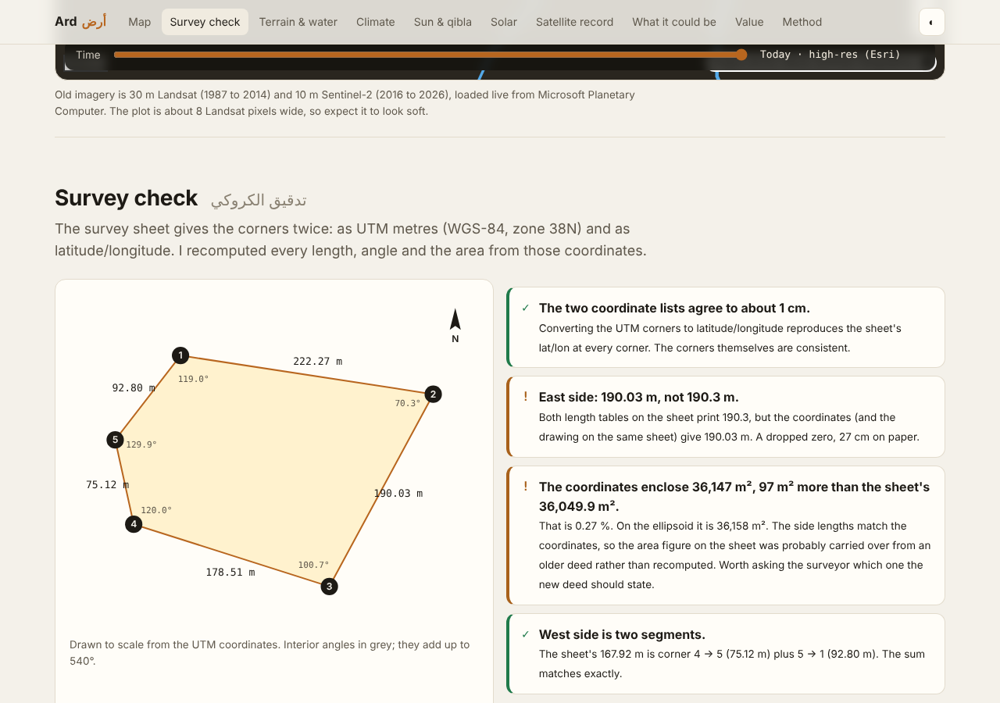
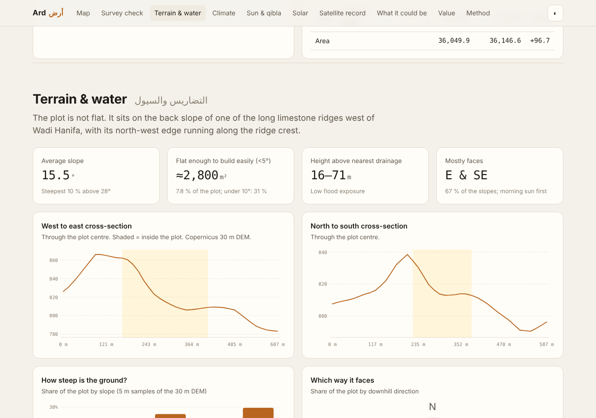

# Ard (أرض): one plot of land, read from orbit

Ard puts a single 3.6 ha plot in Al-Ammariyah, west of Riyadh (plan 623, plot 67), under every free scientific dataset that covers it: the survey's own coordinates, the Copernicus 30 m terrain model, 25 years of NASA POWER weather, 75 years of ERA5 climate reanalysis, 130 monthly Sentinel-2 passes, and Landsat imagery back to 1987. Every number is computed for this exact polygon.

**Live site:** https://mbassam2009.github.io/ard/ (or open `index.html` in a browser; the map needs an internet connection for imagery).

Owner, deed and ID numbers from the survey sheet are deliberately left out of this public repository.

## What it found

| | Result |
|---|---|
| Survey coordinates | UTM and lat/lon lists agree to about 1 cm at every corner |
| East side | **190.03 m**, not the 190.3 m printed in both length tables (the drawing on the same sheet says 190.03) |
| Area | The corners enclose **36,146.6 m²** (36,158 m² on the ellipsoid), 97 m² (0.27 %) more than the 36,049.9 m² on the sheet |
| Terrain | 800 to 864 m elevation inside the plot: 64 m of relief. Mean slope 15.5°; only 8 % of the plot is under 5° and 31 % under 10°. Slopes face mostly east and south-east |
| Water | The plot is at the top of its own small catchment (the most any cell inside collects is about 2.6 ha). It sits 16 to 71 m above the nearest drainage line. A wadi with a 1.4 km² catchment passes about 115 m south-east of corner 3 |
| Earthworks | Levelling the whole plot to one height would mean about 217,000 m³ of cut and the same of fill (about 12 m on average) |
| Climate | July average high 43.0 °C; evaporation demand (FAO-56 ET₀) about 2,670 mm a year against 41 to 75 mm of rain |
| Warming | ERA5 annual mean up 2.3 °C between 1950-79 and 1996-2025 (trend 0.47 °C per decade) |
| Solar | 1,801 kWh per kWp per year on a single-axis tracker, 1,615 fixed at the best tilt (20 to 25° south) |
| Satellite record | Greenness (NDVI) never above 0.11 since 2015: bare rock and gravel, nothing built or graded |
| Neighbourhood | 99 % open rangeland within 1 km; built-up land within 6 km grew from 0.41 % (2017) to 1.83 % (2023) |

## The site

- **Map:** Esri imagery with the surveyed boundary, 3D terrain, drainage lines from the flow model, qibla direction, clickable corners with UTM and lat/lon, and a time slider through Landsat (1987 to 2014) and Sentinel-2 (2016 to 2026) loaded live from Microsoft Planetary Computer. Click anywhere for elevation and distance.
- **Survey check:** the shape drawn to scale from the coordinates, with every side, angle and the area recomputed.
- **Terrain and water:** cross-sections, slope and aspect breakdowns, flood exposure, earthworks.
- **Climate:** average month, rain against evaporation, 75 years of warming, annual rain, very hot days, the wettest days on record.
- **Sun and qibla:** sun position and shadow length for any date and time, sun-path diagram, qibla bearing (242.8°, 763 km).
- **Solar:** monthly yield, best tilt, hour-by-month output, and a sizing calculator.
- **Satellite record:** NDVI and in-plot shadow texture every month since 2015, built-up land around the plot.
- **What it could be:** the numbers each use (rest house, solar, palms, rain harvesting, holding) would have to live with.
- **Value range:** a price-per-m² slider with reference points from registered deals and listings. Arithmetic, not a valuation.

## Files

- `index.html`, `data.js`, `lib/`: the site (MapLibre GL is bundled so the page does not depend on a CDN)
- `data/`: every dataset the site uses, as pulled (see below)
- `analysis/geometry.py`: area, sides, angles, UTM to lat/lon check
- `analysis/build_data.py`: earthworks, climatology, NDVI, and bundling into `data.js`
- `analysis/browser_pipeline.js`: the code that pulled and processed NASA POWER, the PV model, Sentinel-2 statistics, the DEM flow routing, ERA5, land cover and OpenStreetMap. It ran in a browser tab because the build machine could not reach those APIs directly

## Methods in short

- **Reference ET:** FAO-56 Penman-Monteith (daily) on NASA POWER Tmax, Tmin, dew point, 2 m wind, solar radiation and surface pressure.
- **PV:** NOAA sun position; isotropic sky; albedo 0.3; ASHRAE incidence-angle loss; SAPM open-rack cell temperature; −0.37 %/°C; 14 % system losses and a 96 % inverter. Tracker = horizontal N-S axis, ±60°, no backtracking. The results sit on the conservative side of published Riyadh yields.
- **Terrain:** Copernicus GLO-30; priority-flood filling, D8 directions and flow accumulation over a 20 × 22 km window; HAND with a 0.5 km² channel threshold; slopes from a 5 m bilinear resample with 30 m central differences.
- **Sentinel-2:** clearest pass per month (cloud < 15 %), polygon band means from the Planetary Computer statistics API, −1000 offset applied after 25 Jan 2022.

## Limits

- A 30 m terrain model smooths a ridge this sharp. Slope, earthworks and drainage near the boundary are approximate; a drone or total-station survey would settle them.
- The survey names a wadi on the west side. At 30 m the model sees the ridge crest there, not a channel.
- Rain differs between NASA POWER (41 mm/yr, 2001 to 2025) and ERA5 (75 mm/yr, 1996 to 2025); both are gridded estimates, not a gauge on the plot.
- Prices are asking prices and area averages from November 2026, not a valuation. Only a licensed valuer can price the plot.

## Sources

NASA POWER · ECMWF ERA5 via Open-Meteo · Copernicus DEM GLO-30, Sentinel-2 L2A, Landsat Collection 2 L2 and Impact Observatory land cover via Microsoft Planetary Computer · Esri World Imagery · AWS Terrain Tiles · OpenStreetMap · FAO Irrigation and Drainage Paper 56 · Raghdan, Aqar and Bayut market listings · Survey sheet by Saif Engineering Consultation.
